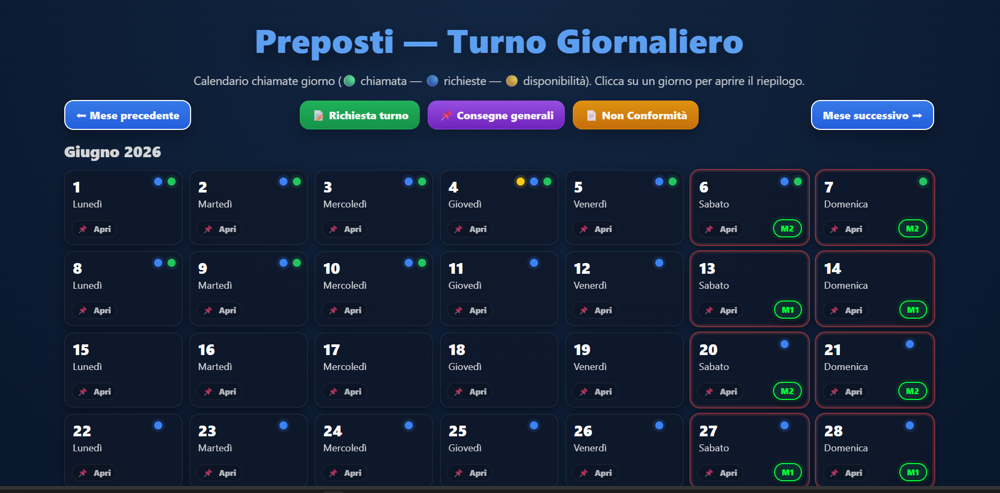
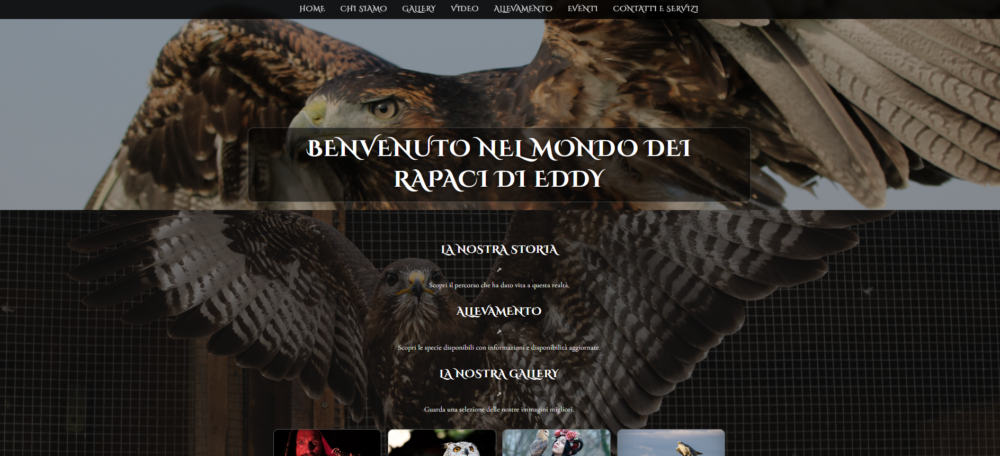
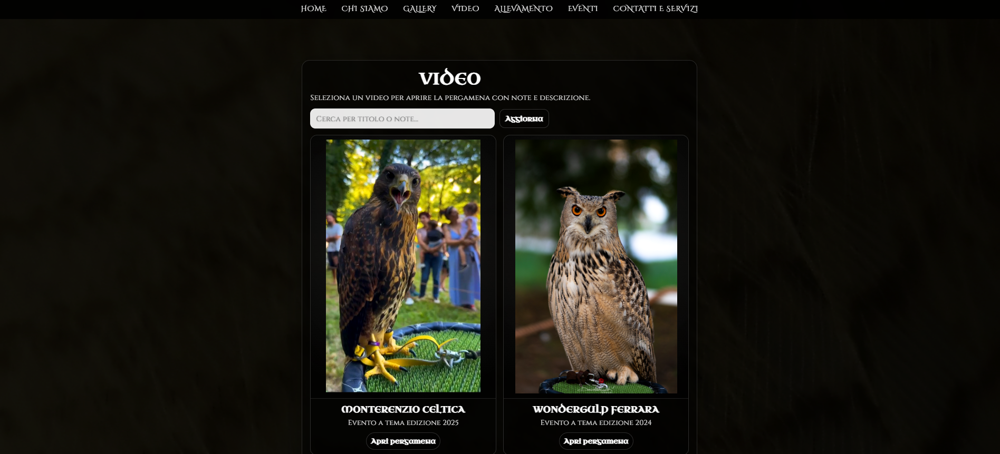

# Nicola Rigoni — Full-Stack Developer Portfolio

I'm Nicola Rigoni, a Full-Stack Developer and Computer Engineering student based in Italy.

I build, improve and debug web applications, internal business tools and digital products. My strongest stack is React, TypeScript, JavaScript, Supabase/PostgreSQL and Python/FastAPI, with practical experience in responsive UI, APIs, authentication, data flows, QA, Git/GitHub and security-minded development.

I currently work on several substantial private projects, so this public repository focuses on safe project summaries, technologies and selected screenshots rather than exposing production source code.

---

## Current freelance focus

I am available for **100% remote freelance and contract work with flexible scheduling**, especially for:

- Bug fixing and maintenance on existing web applications
- React / TypeScript feature development
- Python / FastAPI backend work
- REST API and JSON integrations
- Supabase / PostgreSQL data flows
- Authentication and authorization debugging
- Responsive and mobile usability improvements
- Internal tools and business workflow automation
- Manual QA and regression testing
- Security-minded web application review, including OWASP-oriented checks, access control and Supabase RLS review
- Focused fixed-scope development and maintenance work

---

## Selected projects

### 1. Academy Learning — Adaptive Learning Platform

A private learning platform currently being developed as a commercial product for progressive technical education from absolute beginner level toward professional autonomy.

The commercial preview is being developed separately from the personal learning environment and currently includes a structured multi-module curriculum, guided practice, technical labs, projects, review flows, multilingual content and a tutor-oriented learning architecture.

**Current development highlights:**

- 15-module / 180-lesson canonical roadmap
- 138 authored lessons in the current commercial V62 preview
- Italian, English, Spanish and French content
- Computing foundations, programming, Linux, networks, web development, cybersecurity, AI foundations, AI engineering and AI security
- Guided labs, decision exercises, quizzes, project dossiers and review workflows
- Study paths and progressive learning from beginner foundations to advanced topics
- Local and account-aware tutor/context architecture
- Privacy, authorization, RAG, AI security and cost-control design work
- Extensive automated QA for browser behavior, curriculum integrity and release regressions
- Desktop and mobile-oriented experience

**Technologies and engineering practices:**

- HTML, CSS and JavaScript ES modules
- Supabase Auth / PostgreSQL / Row Level Security
- Supabase Edge Functions
- Node.js testing
- JSDOM and browser-oriented regression checks
- GitHub Actions / CI
- Vercel preview and release workflows
- Privacy-by-design and explicit authorization gates

**Status:** Private repository / commercial preview in active development. Production payments and external AI provider usage are intentionally gated until technical, privacy, cost and release checks are complete.

---

### 2. Remember — Productivity Web App

Remember is a responsive productivity application for reminders, notes, appointments, deadlines, shifts, finance and personal planning.

The project has evolved into a cross-platform application architecture with cloud-backed user data and mobile support.

**Main features:**

- Reminders and deadlines management
- Notes and appointments
- Calendar-based organization
- Shift management
- Personal finance tracking
- Responsive dashboard
- Account-specific data flows
- Cloud-backed persistence
- Mobile-oriented navigation and UX
- Android/iOS application layer through Capacitor
- Local notification support

**Technologies used:**

- React 19
- TypeScript
- JavaScript
- Supabase
- PostgreSQL-backed data
- Vite
- Capacitor
- HTML / CSS
- Git / GitHub

**Status:** In development / private repository

**Screenshots:**

#### Home dashboard

#### Events calendar

#### Shifts and monthly overview

---

### 3. Business Management System — Python / FastAPI

An internal browser-based management application developed to replace scattered manual processes with structured operational workflows.

The full project is private because it contains internal logic, workflow rules and operational data.

**Main features:**

- Multi-section operational dashboard
- Daily planning and scheduling
- Staff availability and shift workflows
- Training and qualification monitoring
- Calendar-based processes
- Document and information organization
- Internal forms and structured data entry
- Repeated business workflow support
- Multi-device browser access
- Ongoing production-oriented maintenance and incremental improvements

**Technologies used:**

- Python
- FastAPI
- HTML
- CSS
- JavaScript
- JSON / structured data
- REST-style application flows
- Git / GitHub

**Status:** Private project / internal use

**Screenshots:**

#### Training and qualification monitoring

#### Daily shift planning calendar

---

### 4. Fitness AI App — Fitness Planning & Assistant

A private fitness application combining workout and meal planning with an AI-oriented assistant experience.

**Main features:**

- Multiple workout plans
- Editable exercises
- Workout diary by plan
- Multiple meal plans
- AI assistant interface
- Assistant conversation synchronization across devices
- Action-decision synchronization
- Responsive mobile-first UX
- Cloud-backed user data

**Technologies used:**

- React 19
- TypeScript
- Supabase
- Vite
- HTML / CSS
- Git / GitHub

**Status:** Private repository / developed product prototype

---

### 5. Valleverde — 3D Life Simulator

A large private 3D life-simulation game project developed with Unity and C# for Windows and Android.

The project includes an evolving open-world environment and multiple gameplay systems, with continuous work on persistence, world interactions, traffic, NPC behavior, mobile usability and performance.

**Areas developed or actively engineered:**

- 3D world and environment systems
- Character identity and persistence
- Save / resume workflows
- Buildings and interactive interiors
- NPC and interaction systems
- Vehicle and traffic systems
- Mobile controls and Android builds
- Windows builds
- Performance and visibility optimization
- Iterative QA across large gameplay systems

**Technologies used:**

- Unity
- C#
- Git / GitHub
- Windows / Android build workflows

**Status:** Private repository / long-term development project

---

### 6. I Rapaci di Eddy — Responsive Website

A responsive multi-page website developed for a real-world showcase use case, with a focus on clear navigation, visual presentation and mobile usability.

**Main features:**

- Responsive layout
- Multi-page website structure
- Mobile-friendly navigation
- Image galleries and content sections
- Front-end implementation
- Production deployment

**Technologies used:**

- HTML
- CSS
- JavaScript
- Responsive Design

**Live website:**

https://irapacidieddy.com/

**Screenshots:**

#### Website home page

#### Breeding / content section

#### Video section

---

## How I work

I prefer focused, testable changes over unnecessary rewrites.

Typical workflow:

1. Reproduce the issue or define the exact product requirement
2. Inspect the affected code, API, database and user flow
3. Identify the root cause or smallest reliable implementation path
4. Implement the fix or feature
5. Test the affected workflow and likely regressions
6. Verify mobile / responsive behavior when relevant
7. Document the change and keep the repository history understandable

For larger projects I also use staged releases, regression gates, CI checks, rollback-aware workflows and explicit separation between preview, testing and production.

---

## Skills

### Web & product development
- React
- TypeScript
- JavaScript
- HTML / CSS
- Responsive UI
- Vite
- Capacitor
- Web application development
- Product-oriented feature development

### Backend & data
- Python
- FastAPI
- REST APIs
- JSON
- SQL
- Supabase
- PostgreSQL
- Authentication / authorization flows
- Row Level Security review

### QA & engineering workflow
- Git / GitHub
- GitHub Actions / CI
- Manual QA
- Regression testing
- Browser and mobile testing
- Debugging existing codebases
- Release-oriented verification
- PowerShell and Linux terminal workflows

### Security-minded development
- OWASP-oriented review
- Access-control and IDOR-oriented testing in authorized environments
- Supabase RLS review
- Auth/session flow analysis
- Privacy and authorization-aware application design

### Additional experience
- Unity
- C#
- Android build workflows
- AI/RAG learning-system architecture and evaluation concepts

---

## Availability

Available for **100% remote, part-time / flexible freelance and contract work**.

Best fit:

- Small and medium bug fixes
- Feature implementation
- Existing web-app maintenance
- API / database integrations
- Internal business tools
- Responsive/mobile improvements
- QA and regression testing
- Security-minded application review
- Fixed-scope development work
- Ongoing maintenance with flexible scheduling

---

## Contact

- Email: nicolarigoni1993@gmail.com
- LinkedIn: https://www.linkedin.com/in/nicola-rigoni-b9443a367
- GitHub: https://github.com/nicolarigoni1993-cloud
